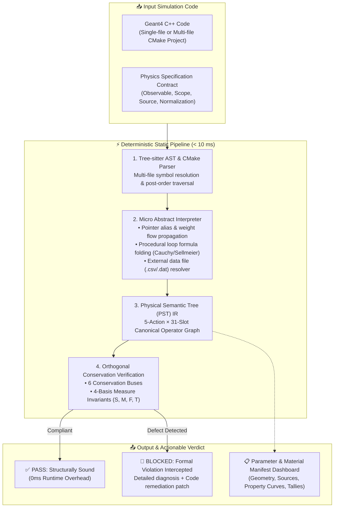
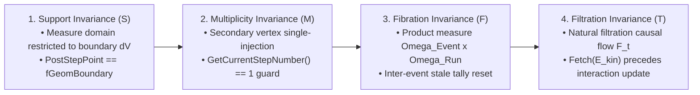

<div align="center">

# ⚛️ NuclearMC-Verifier

### High-Precision Physics Guardrail & Formal Verifier for LLM-Generated Monte Carlo Transport Codes

**[English](README.md) | [中文版](README_zh.md)**

**Deterministic Static Conservation Guardrail & Verification Engine for LLM-Synthesized Monte Carlo Simulation Codes**

<p align="center">
  <a href="https://doi.org/10.5281/zenodo.23231733"></a>
  <a href="LICENSE"></a>
  <a href="https://github.com/SHARK20031010/NuclearMC-Verifier/actions/workflows/ci.yml"></a>
  
  <a href="https://geant4.web.cern.ch/"></a>
  <a href="#-engine-support--roadmap"></a>
  <a href="https://www.python.org/"></a>
  <a href="benchmarks/"></a>
  
  
</p>

[Why NuclearMC-Verifier?](#-why-nuclearmc-verifier) · [Key Features](#-key-features) · [Quick Start](#-quick-start) · [CLI Tool](#-cli-tool-mc-verifier) · [6 Conservation Buses](#-6-orthogonal-physics-conservation-buses) · [5-Action Taxonomy](#-5-action--31-slot-closed-loop-taxonomy) · [Measure Invariants](#-four-basis-measure-invariants--lifecycle-axioms) · [Engine Roadmap](#-engine-support--roadmap) · [Agent Ecosystem](#-agent-ecosystem-integration) · [190-Task Benchmark](#-190-task-benchmark-suite) · [Citation](#-license--citation)

</div>

---

## 💡 Why NuclearMC-Verifier?

Large Language Models (DeepSeek, GPT-4, Claude, etc.) excel at writing general software, but frequently produce critical **"Silent Physical Failures"** when generating continuous phase-space particle and radiation transport simulations (such as Geant4, OpenMC, MCNP):

> **The generated code compiles with 0 warnings, and executes with exit code 0, yet the resulting absorbed dose, particle flux, or radionuclide yield exhibits catastrophic physical distortions of $10^2 \sim 10^7 \times$!**

### Common LLM Hallucinations: Clean Compilation, Catastrophic Physics

```cpp
// ❌ Typical LLM code snippets (100% compilation success, completely invalid physics):

// Case 1: Variance reduction deep-penetration scoring missing track weight (GetWeight() omitted)
fFlux += 1.0; 
// Catastrophic consequence: Split particles are scored at initial full weight (1.0), 
// causing transmitted flux through heavy shields to be overestimated by 10^4 - 10^6 x!

// Case 2: Secondary vertex tally missing generation first-step filter (GetCurrentStepNumber() omitted)
if (track->GetParentID() > 0) { fSecondaryYield++; }
// Catastrophic consequence: Every step taken by secondary particles is counted as a 
// "production event", leading to secondary yield inflation by 1-2 orders of magnitude!

// Case 3: 4pi isotropic point source direction sampling collapsed to a fixed pencil beam
gun->SetParticleMomentumDirection(G4ThreeVector(0., 0., 1.));
// Catastrophic consequence: Fails to sample under spherical solid angle dOmega = sin(theta) dtheta dphi;
// detector solid angle is artificially magnified by dozens of times!
```

### 🛡️ Real-Time Guardrail Interception

Before code reaches compilers or execution runners, NuclearMC-Verifier intercepts flaws in **< 10ms** and outputs actionable physical diagnostics:

```text
$ ./mc-verifier check benchmarks/cases/wild_corpus/WILD-01/code/case_buggy.cc

[Formal Physics Verification - 1 Physical & Framework Contract Violation Detected]:

🚨 [1] Severity: CRITICAL · [Secondary Generation Vertex Missing First-Step Filter (Inflation via Redundant Stepping Accumulation)]
  - Defect Diagnosis: In UserSteppingAction, spatial production or yield of secondary particles
    is tracked without requiring GetCurrentStepNumber() == 1. Hundreds of continuous steps taken
    by secondaries are indiscriminately scored as "creation points", inflating yield by 1-2 orders of magnitude.
  - Targeted Physics Remediation: Add stepping lifecycle guard:
    if (track->GetCurrentStepNumber() == 1) { /* Score vertex only at creation step */ }
```

### 🏗️ Deterministic Pipeline Architecture



---

## ✨ Key Features

- ⚡ **Sub-10ms Pure AST Static Verification**: Requires no local Geant4 build or multi-GB runtime dependencies; driven by lightweight deterministic AST parsing and first-principles conservation rules (<10ms per file).
- 🛡️ **6 Orthogonal Physics Conservation Buses**: Exhaustive coverage across relativistic causality, phase-space angular measure, fair-game weight flux, stepping lifecycle, nuclear decay chains, and upstream intent specifications.
- 📐 **Four-Basis Measure Invariants**: Enforces mathematical measure consistency: Support Invariance ($\mathcal{S}$), Multiplicity Invariance ($\mathcal{M}$), Fibration Invariance ($\mathcal{F}$), and Filtration Invariance ($\mathcal{T}$).
- 🔍 **Universal Parameter & Material Extractor**: Statically unfolds continuous property curves $f(E)$ from procedural `for` loops (e.g. Cauchy optics), resolves external `.csv`/`.dat` streams, classifies detector component roles, and validates thermal neutron $S(\alpha, \beta)$ scattering.
- 🔌 **Native 5-Agent Ecosystem Adapters**: Out-of-the-box support for **Google Antigravity**, **DeepSeek Harness (DSH)**, **Anthropic Claude Code**, **OpenCode**, and standard **MCP (Model Context Protocol)**.
- 🎯 **5-Action × 31-Slot Closed-Loop Taxonomy**: Deconstructs Monte Carlo dataflows into fundamental operators: `Define`, `Sample`, `Fetch`, `Accumulate`, `Convert` — leaving zero room for empirical parameter fitting.
- 🧪 **Comprehensive 190-Task Benchmark Suite**: Spanning 6 core physics domains (shielding, dosimetry, activation, detectors, microdosimetry, and accelerator sources), with complete problem specs, prompts, and multi-arm comparative source codes.

---

## 🚀 Quick Start

### 1. Installation

Requires Python 3.9+. Simply clone and install:

```bash
git clone https://github.com/SHARK20031010/NuclearMC-Verifier.git
cd NuclearMC-Verifier

# Recommended: standard install (provides global mc-verifier and mc-v CLI commands)
pip install -e .

# Or install dependencies via requirements.txt
pip install -r requirements.txt
```

### 2. Verify Your Simulation Code

```bash
# Verify a single Geant4 C++ simulation file
./mc-verifier check path/to/your_simulation.cc

# Inspect full physical parameter manifest (geometry, materials, curves, sources, tallies)
./mc-verifier inspect path/to/your_simulation.cc

# Quick Test: Check bundled examples (instant defect diagnosis & remediation diff)
./mc-verifier check examples/01_boundary_leak.cc
./mc-verifier check examples/02_unweighted_variance_reduction.cc
./mc-verifier check examples/03_scintillator_without_birks.cc

# Quick Test: Check compliant baseline code from the benchmark suite
./mc-verifier check benchmarks/cases/tier1_single_slot/T1-4/code/code_ArmC.cc

# Batch Check: Verify multiple files in a single pass
./mc-verifier check examples/*.cc
```

### 3. Git Pre-commit Linter Integration

NuclearMC-Verifier can run automatically as a pre-commit hook in any Geant4 / Monte Carlo project. Add the following to your project's `.pre-commit-config.yaml`:

```yaml
repos:
  - repo: https://github.com/SHARK20031010/NuclearMC-Verifier
    rev: v0.1.0  # Or commit SHA / tag
    hooks:
      - id: nuclearmc-verifier
```

Every `git commit` will automatically audit changed C++ simulation files for physical conservation violations and block unphysical commits before they reach the repository!

---

## 🛠️ CLI Tool (`./mc-verifier`)

A unified command-line interface [`./mc-verifier`](mc-verifier) is provided in the repository root:

| Command | Description |
| :--- | :--- |
| `./mc-verifier check <file(s)...>` | Run joint dual-core formal verification (PST + conservation bus, supports batch files) |
| `./mc-verifier inspect <file>` | **Parameter Manifest**: Inspect extracted geometry, property curves, sources, & tally metrics in &lt;10ms |
| `./mc-verifier check-pst <file>` | **PST Verification**: Build Physical Semantic Tree (PST) IR and assert measure-algebraic invariants |
| `./mc-verifier eval-pst` | Run the standard PST evaluation benchmark across multi-arm source test cases |
| `./mc-verifier on` | **Enable Guardrail**: Activate rigid physics conservation blocking across all agent platforms |
| `./mc-verifier off` | **Disable Guardrail**: Deactivate blocking (strict 0ms No-Op pass-through mode) |
| `./mc-verifier status` | View current guardrail switch status and harness readiness dashboard |
| `./mc-verifier install-all` | Automatically register skills, hooks, and adapters to all detected agent harnesses |

### 📋 Physical Parameter Manifest Showcase (`./mc-verifier inspect`)

Run `./mc-verifier inspect` to instantly extract and audit physical parameters without compiling or running Geant4:

```text
$ ./mc-verifier inspect benchmarks/cases/tier1_single_slot/T4-3/code/code_ArmC.cc

┌──────────────────────────────────────────────────────────────────────────────────┐
│  📋 Code Parameter Manifest (Universal Physics Parameter Extraction)             │
├──────────────────────────────────────────────────────────────────────────────────┤
│  Target: benchmarks/cases/tier1_single_slot/T4-3/code/code_ArmC.cc [7.34 ms] │
│  Project Architecture: Single-file C++ Compilation Unit                          │
├──────────────────────────────────────────────────────────────────────────────────┤
│  [1. Radiation Source Parameters]                                                │
│    • Primary Energy: 1.0 * MeV           Beam On Events: 1                       │
│    • Position: {0, 0, -5 * cm}           Direction Vector: {0, 0, 1}             │
│    • Angular Measure: Pencil Beam (Collimated: {0, 0, 1})                        │
├──────────────────────────────────────────────────────────────────────────────────┤
│  [2. Geometry Topology & Detector Roles]                                         │
│    • world     [G4Box] Material: G4_AIR       Role: World Container              │
│      └─ Dimensions: half_x=20*cm, half_y=20*cm, half_z=20*cm                    │
│    • sc        [G4Box] Material: PlasticScint Role: Active Crystal / Sensitive   │
│      └─ Dimensions: half_x=2.5*cm, half_y=2.5*cm, half_z=2.5*cm                 │
├──────────────────────────────────────────────────────────────────────────────────┤
│  [3. Continuous Property Curves f(E)]                                            │
│    • PlasticScint -> RINDEX                (N=10) [Monotonic Increasing · Sound] │
│      └─ Domain: [1.50, 6.00] eV   Range: [1.33, 1.36]  Origin: Procedural Loop   │
│    • PlasticScint -> SCINTILLATIONCOMPONENT1 (N=2) [Monotonic Increasing · Sound] │
│      └─ Domain: [1.00, 6.00] eV   Range: [1.00, 1.00]  Origin: Declarative Array │
├──────────────────────────────────────────────────────────────────────────────────┤
│  [5. Physics List & Microscopic Models]                                          │
│    • Primary Physics: ModularPhysicsList   Modules: G4OpticalPhysics             │
│    • Birks Quenching Constant: 0.126 * mm / MeV                                  │
│    • Features: Optical Physics (G4OpticalPhysics), High-Precision Neutrons (HP)  │
├──────────────────────────────────────────────────────────────────────────────────┤
│  [6. Tally Responses & Observables]                                              │
│    • Fluence TLE: `realfluxContribution` [Weight Preservation: ENABLED]          │
├──────────────────────────────────────────────────────────────────────────────────┤
│  [7. Run Control & Variance Reduction]                                           │
│    • Engine: G4RunManager (Single Thread)  Variance Reduction: Analog Sampling   │
└──────────────────────────────────────────────────────────────────────────────────┘
```

### Configuration File (`.mc-verifier.yaml`)

Audit strictness and individual physics buses can be configured in `.mc-verifier.yaml`:

```yaml
enabled: true               # Master switch
strict_mode: true           # true: block on violations; false: output warnings only
require_specification: true # Enforce upstream Ring 0 specification contract (geometry, source, activity, norm)

invariants:
  energy_conservation: true      # Energy and momentum conservation bus
  conserved_quantum_numbers: true# Lepton / baryon / charge conservation bus
  phase_space_measure: true      # Phase space and solid angle measure bus
  fair_game_weight: true         # Fair-game weight flux and variance reduction bus
  dimensional_linearity: true    # Dimensional analysis and response scaling bus
  framework_api_contracts: true  # Lifecycle and framework semantics contract bus
```

---

## 🔬 6 Orthogonal Physics Conservation Buses

A Monte Carlo transport code maps upstream user requirements, microscopic physics laws, and program control flow into a Directed Acyclic Graph (DAG). NuclearMC-Verifier is driven by 6 orthogonal core verifiers (`guardrail/engine/cores/`), asserting invariants along the topological execution order:

| Conservation Bus | Core Source | Physics & Code Causal Propagation Chain |
| :--- | :--- | :--- |
| 🎯 **Upstream Intent Bus** | `intent_core.py` | **Requirement $\rightarrow$ Observable $\rightarrow$ Spatial Scope $\rightarrow$ Dimensional Unit $\rightarrow$ Normalization Base (DAG Root)**<br>• Eliminates upstream natural-language ambiguity. Ensures target physical observables (dose vs. fluence vs. activity), sensitive region volume/mass measure ($V \times \rho$), and normalization denominators (per-primary vs. absolute source strength) form a complete causal chain. |
| 🌐 **Phase-Space & Measure Bus** | `measure_core.py` | **Source Specification $\rightarrow$ Spectral Manifold $\rightarrow$ Spatial Density $\rightarrow$ Solid Angle Measure ($d\Omega = \sin\theta d\theta d\phi$)**<br>• Enforces measure-preserving transformations on differential manifolds: non-negative energy truncation, circular source radial Jacobian transformation ($r = R\sqrt{\xi}$), and 4π isotropic spherical solid angle sampling, preventing collapse into Cartesian linear sampling or fixed pencil beams. |
| ⚛️ **Nuclear Data & Cross-Section Bus** | `nuclear_core.py` | **Material Nuclides $\rightarrow$ Energy Range Coverage $\rightarrow$ Evaluated Cross-Section Libraries $\rightarrow$ Decay Cascades**<br>• Microscopic interaction probabilities are strictly bound: mandatory thermal neutron $S(\alpha,\beta)$ cross sections, seamless energy overlap between electromagnetic/hadronic physics models, official ENSDF/NuDat decay databases and Bateman chains, and Birks' quenching corrections. |
| ⏱️ **Causality & Timing Bus** | `causality_core.py` | **Laboratory Clock $\rightarrow$ Global Time $\rightarrow$ Particle Proper Lifetime $\rightarrow$ Coincidence Time Windows**<br>• Maintains relativistic causality: explicit isolation between global experiment time (`GetGlobalTime`) and particle local lifetime (`GetLocalTime`), monotonic time-of-flight (TOF) ordering, two-detector coincidence window gating, and pulsed beam / coolant residence time tracking. |
| 🔄 **Stepping Lifecycle Bus** | `lifecycle_core.py` | **Track Creation $\rightarrow$ Step Advance $\rightarrow$ Boundary Crossing $\rightarrow$ Sensitive Volume Gating $\rightarrow$ Container Lifecycle Reset**<br>• Tracks discrete state machine transitions: secondary generation first-step filter (`GetCurrentStepNumber() == 1`), creator process identification (`GetCreatorProcess`), post-step boundary state checking, dead-layer energy deposition isolation, and inter-event stale tally contamination elimination. |
| ⚖️ **Weight Flux & Variance Bus** | `variance_core.py` | **True Transport Measure $\rightarrow$ Splitting / Russian Roulette Bias $\rightarrow$ Dynamic Weight Compensation $\rightarrow$ Unbiased Estimator**<br>• Enforces the "Fair-Game" transport theorem: under geometric splitting or weight windows, split track weights $w$ decrease dynamically; tallies must strictly multiply weights $\sum (x_i \cdot w_i)$, preventing unweighted tally explosions of several million-fold. |

---

## 🎯 5-Action × 31-Slot Closed-Loop Taxonomy

Monte Carlo transport dataflows are canonically decomposed into five primitive operators: **Define**, **Sample**, **Fetch**, **Accumulate**, and **Convert**, covering 31 fine-grained physical slots without empirical parameter tuning:

| Canonical Action | Physical Semantic Role | Key Physical Slots Checked |
| :--- | :--- | :--- |
| **`Define`** | Static Phase Space & Medium Construction | Geometry solids, detector active vs. dead-layer roles, continuous property grids $f(E)$, thermal scattering $S(\alpha, \beta)$ binding, physics process registration |
| **`Sample`** | Stochastic Variate Generation | Spherical solid angle $d\Omega = \sin\theta d\theta d\phi$, radial density $r = R\sqrt{\xi}$, energy spectrum non-negative truncation, emission timing |
| **`Fetch`** | Pre-Interaction Kinematic State Access | Particle kinetic energy prior to scattering (Filtration $\mathcal{F}_t$), local lifetime vs. global clock, creator process identity |
| **`Accumulate`** | Phase Space Integration & Tally Scoring | Track-length fluence (TLE: $\sum w \ell / V$), surface flux, energy deposition, weight preservation ($w \cdot x$), secondary first-step filter |
| **`Convert`** | Response Scaling & Normalization | Dose conversion ($Gy = J/kg$), FWHM Gaussian broadening, decay activity ($Bq \leftrightarrow Ci$), per-primary beam-current normalization |

---

## 📐 Four-Basis Measure Invariants & Lifecycle Axioms

In stochastic transport simulation, continuous Phase-Space integration $I = \int_{\Omega} f \, d\mu$ is discretized. Statistical unbiasedness ($\mathbb{E}[\hat{I}] = I$) strictly requires satisfying the **Four-Basis Measure Invariants**:



1. **Support Invariance ($\mathcal{S}$ · Boundary Gate)**:
   - Interface particle flux must have its measure support strictly confined to the boundary manifold $\partial V$.
   - Enforces `PostStepPoint` status checking; prevents interior steps from inflating boundary flux.
2. **Multiplicity Invariance ($\mathcal{M}$ · Multiplicity Slot)**:
   - Indicator measures along particle tracks must not spuriously multiply.
   - Secondary particle yield scoring must satisfy single-step injection (`GetCurrentStepNumber() == 1`) or unique track ID sets (`insert(trackID)`), preventing hundreds of subsequent steps from triggering duplicate vertex scores.
3. **Fibration Invariance ($\mathcal{F}$ · Hierarchy Slot)**:
   - The product measure space $\Omega_{\text{Event}} \times \Omega_{\text{Run}}$ requires strict finite-lifecycle isolation.
   - Event-level tally containers must satisfy the temporal safety property $\square (\text{Accumulate}(x) \implies \Diamond_{\text{past}} \text{Reset}(x, \text{Tier}_{\text{Event}}))$, eliminating inter-event stale tally leaks.
4. **Filtration Invariance ($\mathcal{T}$ · Ordering Slot)**:
   - Physical observables must be evaluated with respect to the forward natural stochastic filtration $\mathcal{F}_t$ prior to state updates.
   - Prohibits fetching initial kinetic energy after reaction scattering, which causes systemic negative bias.

---

## 🧭 Engine Support & Roadmap

Monte Carlo radiation transport involves two orthogonal layers: **first-principles physical conservation laws** and **code expression in specific simulation engines**. NuclearMC-Verifier employs a decoupled architecture of **"Universal Physics Conservation Buses + Modular Front-End Syntax Adapters"**:

| Simulation Engine | Syntax & Paradigm | Implementation Status | Benchmark Validation |
| :--- | :--- | :--- | :--- |
| **Geant4** | **C++** (OOP hooks, stepping state-machine, pointers) | 🟢 **Fully Implemented (v1.0)** | **190 Tasks Fully Covered** (Tiers 1–3 + Wild Corpus 100% closed-loop) |
| **OpenMC** | **Python API** (Declarative materials, sources, tally filters) | 🟡 **On Roadmap** | Physics buses ready; Python AST visitor in development |
| **MCNP / FLUKA** | **Card-Based Input** (SDEF, F4/F8 tallies, FM multipliers) | ⚪ **Planned** | Card syntax stream parser planned |

> [!NOTE]
> **Why is v1.0 specialized for Geant4?**  
> 1. **Highest Code Generation Risk**: Geant4 (C++) has the steepest learning curve and deepest lifecycle hooks (inter-event container resets, stepping state-machine transitions, step-size boundary oscillations). LLMs consistently generate clean-compiling yet physically disastrous code here. We focused v1.0 on delivering 100% closed-loop verification across 190 tasks with zero false positives or false negatives.  
> 2. **Universal Underlying Methodology**: Ring 0 intent contracts (`intent_core.py`), nuclear decay databases (`nuclear_core.py`), and the 5-Action taxonomy (`Define → Sample → Fetch → Accumulate → Convert`) are completely engine-agnostic. OpenMC's structured Python API makes AST extraction even more deterministic than C++, and will seamlessly plug into the same 6 conservation buses.

---

## 🤖 Agent Ecosystem Integration

NuclearMC-Verifier provides native integration with major AI coding agents, intercepting physical flaws at generation time:

```text
                        ┌─────────────────────────┐
                        │   NuclearMC-Verifier    │
                        └────────────┬────────────┘
         ┌───────────────────┼───────────┴───────┬───────────────────┐
         ▼                   ▼                   ▼                   ▼
 Google Antigravity     DSH (Cordis)        Claude Code         OpenCode / MCP
   Pre-exec Hook       Waterfall Gate       MCP / Skill        Native RPC Server
```

### 1. Google Antigravity (AGY)
- Located at `.agents/plugins/mc-formal-verifier/`, mounted via `hooks.json` as a Pre-execution hook;
- Automatically intercepts C++ Monte Carlo code generation prior to compilation.

### 2. DeepSeek Harness (DSH)
- Located at `adapters/dsh/`, integrated with the Cordis lifecycle service;
- Real-time pre-execution inspection on `write`, `edit`, and `bash` tool calls via `tools/pre-execute` waterfall gates;
- Provides `/mc-status`, `/mc-on`, `/mc-off`, and `/mc-verify` slash commands.

### 3. Anthropic Claude Code & OpenCode
- Loadable as a Skill via `adapters/skills/mc-verifier/SKILL.md`;
- Standard Model Context Protocol (MCP) server integration:
  ```bash
  # Register in Claude Code
  claude mcp add mc-verifier python3 adapters/mcp/server.py

  # Register in OpenCode
  opencode mcp add mc-verifier python3 adapters/mcp/server.py
  ```

### 4. Generic MCP Clients (Cursor / Windsurf / Claude Desktop)
Add the server entry to your `mcp.json`:
```json
{
  "mcpServers": {
    "nuclear-mc-verifier": {
      "command": "python3",
      "args": ["/absolute/path/to/NuclearMC-Verifier/adapters/mcp/server.py"]
    }
  }
}
```

> 💡 **One-Click Setup**: Run `./mc-verifier install-all` to automatically detect your local environment and register skills, hooks, and symlinks across all platforms!

---

## 📊 190-Task Benchmark Suite

To evaluate the guardrail's effectiveness, extensive multi-arm comparative experiments were conducted across **190 curated Monte Carlo simulation tasks** covering 6 physics domains:

| Evaluation Tier | Task Count | Direct Generation (Arm A) | Multi-Turn Self-Reflect (Arm B) | With Verifier (Arm C, Ours) | Core Physics Targets & Traps |
| :--- | :---: | :---: | :---: | :---: | :--- |
| **Tier 1 (Single Slot)** | 60 | 41.7% (25/60) | 98.3% (59/60) | **100.0% (60/60)** | Material cross sections, primary sources, single-volume geometry |
| **Tier 2 (Coupled Modules)** | 60 | 0.0% (0/60) | 36.7% (22/60) | **100.0% (60/60)** | Multi-region interfaces, nanosecond pulses, decay chains, micro-stepping |
| **Tier 3 (Multi-Constraint)** | 60 | 0.0% (0/60) | 53.3% (32/60) | **100.0% (60/60)** | Geometric splitting & weight windows, thin foils, fluid activation & heating |
| **Wild Corpus (Real Bugs)** | 10 | 0.0% (0/10) | 0.0% (0/10) | **100.0% (10/10)** | Long-tail silent defects harvested from CERN forums & GitHub repos |
| **Overall (Micro-Average)** | **190** | **13.2% (25/190)** | **59.5% (113/190)** | **100.0% (190/190)** | **Self-reflection suffers cognitive cliff; verifier achieves 100% closed-loop remediation** |

The full 190-task experimental dataset (including prompts, task descriptions, and multi-arm codes) is archived on [Zenodo (10.5281/zenodo.23231733)](https://doi.org/10.5281/zenodo.23231733). Representative evaluation benchmarks and Golden-PST ground truth are maintained in [`benchmarks/`](benchmarks/):
- See detailed benchmark documentation: [benchmarks/README.md](benchmarks/README.md).

---

## 📁 Repository Structure

```text
NuclearMC-Verifier/
├── guardrail/                         # Formal verification core engine
│   ├── engine/                        # 6 conservation cores & universal dispatcher
│   │   ├── cores/                     # Causality, measure, variance, lifecycle, nuclear, intent
│   │   ├── slot_inquisitor.py         # 5-Action × 31-Slot meta-inquisitor
│   │   └── universal_engine.py        # Unified verification engine
│   ├── rules/                         # 66 formal physics rules (PHYS-0001 ~ PHYS-0066)
│   ├── data/                          # Official decay reference data and material tables
│   └── check.py                       # Static verification CLI entry point
├── src/                               # 5-Layer Physics Semantic Tree (PST) IR engine
├── adapters/                          # Multi-platform agent adapters
│   ├── antigravity/                   # Google Antigravity execution hook
│   ├── dsh/                           # DeepSeek Harness Cordis plugin
│   ├── mcp/                           # Model Context Protocol standard server
│   └── skills/                        # Cross-platform Skill definition
├── benchmarks/                        # Verification benchmark suite & Golden-PST annotations
├── scripts/                           # Unified CLI and verification scripts
├── mc-verifier                        # Master CLI executable
├── PHYSICS_SPEC.md                    # Formal physics specification whitepaper
├── CITATION.cff                       # Academic citation metadata
├── .zenodo.json                       # Zenodo archival metadata
├── LICENSE                            # Apache 2.0 Open Source License
├── requirements.txt                   # Dependency list
├── README_zh.md                       # 中文说明文档 (Chinese Documentation)
└── README.md                          # Main English Documentation
```

---

## 📄 License & Citation

This project is licensed under the **Apache License 2.0** — see [LICENSE](LICENSE) for details.

If you use NuclearMC-Verifier or the 190-task benchmark in your research, computational physics, or AI safety engineering, please cite:

```bibtex
@software{nuclearmc_verifier_2026,
  author       = {{NuclearMC-Verifier Contributors}},
  title        = {{NuclearMC-Verifier: High-Precision Physics Guardrail for LLM-Generated Monte Carlo Transport Codes}},
  year         = {2026},
  publisher    = {Zenodo},
  doi          = {10.5281/zenodo.23231733},
  url          = {https://doi.org/10.5281/zenodo.23231733}
}
```
