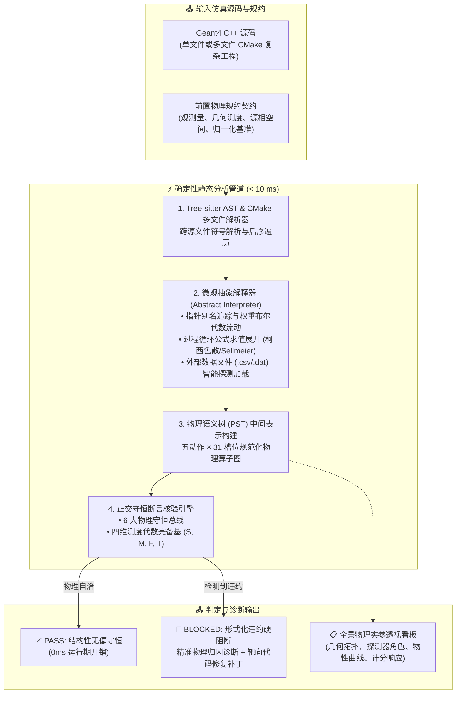
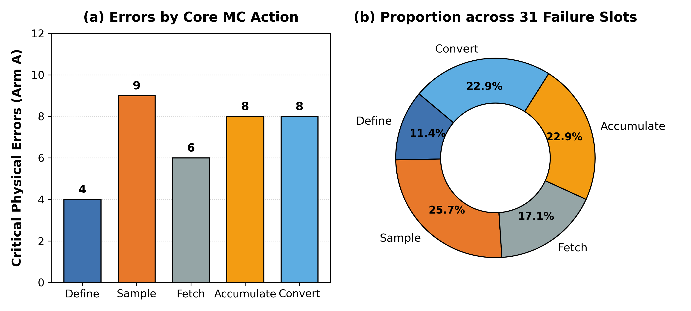
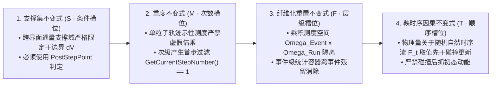
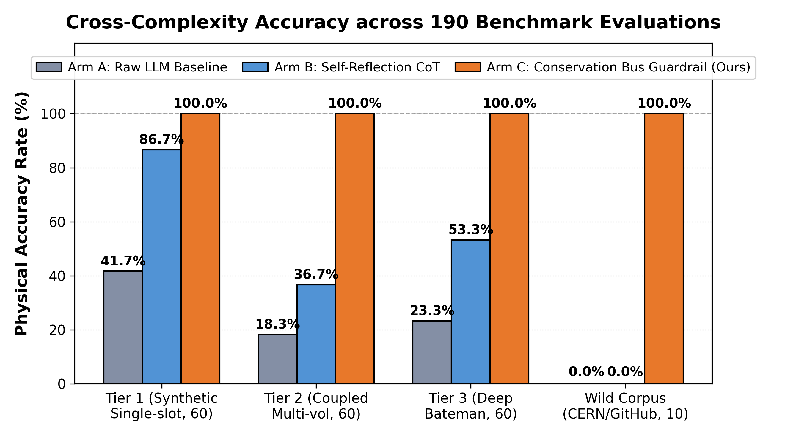

<div align="center">

# ⚛️ NuclearMC-Verifier

### High-Precision Physics Guardrail & Formal Verifier for LLM-Generated Monte Carlo Transport Codes

**[English](README.md) | [中文版](README_zh.md)**

**大语言模型编写蒙特卡罗物理仿真代码的确定性守恒核验器与防幻觉护栏**

<p align="center">
  <a href="https://doi.org/10.5281/zenodo.23231733"></a>
  <a href="LICENSE"></a>
  
  <a href="https://geant4.web.cern.ch/"></a>
  <a href="#-引擎支持与路线图-engine-support--roadmap"></a>
  <a href="https://www.python.org/"></a>
  <a href="benchmark_tasks_reference/"></a>
  
  
</p>

[痛点与演示](#-为什么需要它) · [核心特性](#-核心特性) · [快速上手](#-快速上手) · [CLI 总控工具](#-cli-总控工具) · [6 大物理守恒总线](#-6-大物理守恒总线与逻辑传导链) · [五动作与31槽位](#-五动作--31-槽位闭环分类学-5-action--31-slot-taxonomy) · [四维测度代数完备基](#-四维测度代数完备基与时序公理-measure-theoretic-four-basis) · [引擎支持与路线图](#-引擎支持与路线图-engine-support--roadmap) · [智能体生态集成](#-智能体生态集成) · [190 题基准库](#-190-题评测基准库) · [开源许可与引用](#-开源许可与引用)

</div>

---

## 💡 为什么需要它？

大语言模型（DeepSeek、GPT-4、Claude 等）编写通用软件时得心应手，但在**粒子与辐射输运数值模拟（如 Geant4、OpenMC、MCNP 等）**这种高维连续相空间物理计算中，极易产生极其隐蔽的**“静默物理错误”（Silent Physical Failures）**：

> **代码 0 警告编译通过，事件循环退出码为 0，但模拟输出的吸收剂量、粒子通量或核素产额却发生 $10^2 \sim 10^7$ 倍的灾难性物理畸变！**

### 典型翻车案例：编译完全通过，物理结果全错

```cpp
// ❌ 常见大模型代码片段（编译 100% 成功，物理计算全错）：
// 案例 1：方差缩减深穿透计算，计分漏乘粒子权重 (GetWeight 缺失)
fFlux += 1.0; 
// 致命后果：几何分裂产生的大量次级粒子全按 1.0 全权重累加，深穿透通量虚高数百万倍！

// 案例 2：次级粒子产生顶点统计，未过滤首步 (GetCurrentStepNumber 缺失)
if (track->GetParentID() > 0) { fSecondaryYield++; }
// 致命后果：次级粒子在介质中向前输运的数百个步点全部被当成“产生点”重复累加，产额虚高 1~2 个量级！

// 案例 3：4pi 点放射源发射方向抽样，退化为固定单向束
gun->SetParticleMomentumDirection(G4ThreeVector(0., 0., 1.));
// 致命后果：未按球面度测度 dOmega = sin(theta) dtheta dphi 抽样，探测器立体角人为放大数十倍！
```

### 🛡️ NuclearMC-Verifier 实测拦截效果

在代码提交编译器或执行前，NuclearMC-Verifier 在 **< 10ms** 内直接拦截并给出物理诊断与自查建议：

```text
$ ./mc-verifier check benchmark_tasks_reference/wild_corpus/WILD-01/code/case_buggy.cc

【形式化物理核验结果 - 拦截到 1 项物理与框架契约违约】：

🚨 [1] 严重度：CRITICAL · 【次级粒子空间产生顶点未过滤产生首步 (全步点重复累加虚高)】
  - 缺陷诊断：在 UserSteppingAction 中对次级粒子进行空间产生深度分布或产额统计时，
             未限制 GetCurrentStepNumber() == 1。次级粒子诞生后在介质中输运的连续步点全部
             被无差别当作『产生点』累加，导致产额虚高 1~2 个数量级。
  - 针对性修复建议：增加首步产生生命周期判定：
             if (track->GetCurrentStepNumber() == 1) { /* 仅在诞生首步记录顶点与统计产额 */ }
```

### 🏗️ 确定性核验处理管道架构



---

## ✨ 核心特性

- ⚡ **毫秒级纯 AST 静态解析**：无需安装或编译数十 GB 的 Geant4 C++ 运行环境，纯 AST 与第一性原理规则驱动，单文件核验耗时 **< 10ms**。
- 🛡️ **6 大正交物理防护总线**：全面覆盖因果时钟、相空间立体角测度、方差缩减权重流、步进微生命周期、核素衰变数据库以及前置输入意图契约。
- 📐 **四维测度代数完备基约束**：严密核验离散相空间积分的测度支撑集 ($\mathcal{S}$)、示性测度重度 ($\mathcal{M}$)、乘积测度纤维化 ($\mathcal{F}$) 与鞅因果时序 ($\mathcal{T}$)。
- 🔍 **泛用型物理实参显式提取**：能够符号展开并安全计算 `for` 循环中的动态公式（如柯西色散、Sellmeier）、探测读取外部 `.csv/.dat` 数据流、识别探测器组件角色，并交叉核验热中子晶格散射核 $S(\alpha, \beta)$。
- 🔌 **5 大 Agent 平台原生适配**：开箱即用支持 **Google Antigravity**、**DeepSeek Harness (DSH)**、**Anthropic Claude Code**、**OpenCode** 及标准 **MCP (Model Context Protocol)**。
- 🎯 **五动作 × 31 槽位闭环分类学**：将蒙卡物理数据流解构为「定、抽、取、记、换」五个基础算子，彻底封死常数伪拟合空间。
- 🧪 **190 题完整评测基准套件**：涵盖屏蔽、剂量、活化、探测器、微剂量、束流源项 6 大物理领域，提供完整任务、提示词与三组对照源码。

---

## 🚀 快速上手

### 1. 安装依赖

本项目基于 Python 3.9+ 构建，克隆即可运行：

```bash
git clone https://github.com/SHARK20031010/NuclearMC-Verifier.git
cd NuclearMC-Verifier

pip install -r requirements.txt
```

### 2. 检查你的蒙卡代码

```bash
# 检查单文件 Geant4 C++ 源码
./mc-verifier check path/to/your_simulation.cc

# 物理实参透视 (直接扒出几何体、介质物性曲线、辐射源与计分全景)
./mc-verifier inspect path/to/your_simulation.cc

# 快速体验：检查基准库中的合规代码 (输出：底层契约核验通过)
./mc-verifier check benchmark_tasks_reference/tier1_single_slot/T1-1/code/code_ArmA.cc

# 快速体验：检查基准库中的缺陷代码 (输出：精准缺陷诊断与修复代码)
./mc-verifier check benchmark_tasks_reference/wild_corpus/WILD-01/code/case_buggy.cc
```

---

## 🛠️ CLI 总控工具

项目根目录下提供统一的命令行可执行脚本 [`./mc-verifier`](mc-verifier)：

| 命令 | 说明 |
| :--- | :--- |
| `./mc-verifier check <文件>` | 对指定的 Geant4 C++ 代码执行静态物理守恒核验 |
| `./mc-verifier inspect <文件>` | **实参透视看板**：毫秒级提取几何实体、物性曲线、粒子源项与计分统计 |
| `./mc-verifier check-pst <文件>` | **PST 形式化核验**：构建物理语义树 (PST) 中间表示并断言测度不变式 |
| `./mc-verifier eval-pst` | 批量运行 PST 物理基准评测套件 (统计精确率、召回率与平均延迟) |
| `./mc-verifier on` | **开启门禁**：在所有集成的 Agent 平台中激活刚性物理守恒阻断 |
| `./mc-verifier off` | **关闭门禁**：所有 Agent 进入严格 0ms No-Op 直通放行模式 |
| `./mc-verifier status` | 查看当前核验启闭状态与 5 大 Harness 就绪看板 |
| `./mc-verifier install-all` | 一键向本地全部 Agent 平台自动注册技能与适配器 |

### 📋 物理实参全景透视演示 (`./mc-verifier inspect`)

无需安装或编译 Geant4，运行 `./mc-verifier inspect` 在 7 毫秒内透视仿真程序的底层物理构成：

```text
$ ./mc-verifier inspect benchmark_tasks_reference/tier1_single_slot/T4-3/code/code_ArmC.cc

┌──────────────────────────────────────────────────────────────────────────────────┐
│  📋 蒙特卡罗仿真输入参数显式清单 (Code Parameter Manifest)                     │
├──────────────────────────────────────────────────────────────────────────────────┤
│  目标路径: benchmark_tasks_reference/tier1_single_slot/T4-3/code/code_ArmC.cc [7.34 ms] │
│  工程架构: 单文件 C++ 编译单元                                                   │
├──────────────────────────────────────────────────────────────────────────────────┤
│  [1. 辐射源项参数 (Radiation Source)]                                             │
│    • 初级能量: 1.0 * MeV                 事件历史: 1                             │
│    • 发射位置: {0, 0, -5 * cm}           动量向量: {0, 0, 1}                     │
│    • 角分布测度: 单向平行束 (Pencil Beam: {0, 0, 1})                             │
├──────────────────────────────────────────────────────────────────────────────────┤
│  [2. 几何拓扑与探测器构件 (Geometry & Detector Modeling)]                          │
│    • world     [G4Box] 介质: G4_AIR       角色: World 容器 (World Container)     │
│      └─ 尺寸: half_x=20*cm, half_y=20*cm, half_z=20*cm                           │
│    • sc        [G4Box] 介质: PlasticScint 角色: 灵敏探测晶体 (Active Crystal)    │
│      └─ 尺寸: half_x=2.5*cm, half_y=2.5*cm, half_z=2.5*cm                        │
├──────────────────────────────────────────────────────────────────────────────────┤
│  [3. 介质连续物性数组曲线 f(E) (Continuous Property Curves)]                       │
│    • PlasticScint -> RINDEX                (N=10) [单调递增 · 合规]              │
│      └─ 自变量: [1.50, 6.00] eV   取值: [1.33, 1.36]  来源: 动态循环公式生成     │
│    • PlasticScint -> SCINTILLATIONCOMPONENT1 (N=2) [单调递增 · 合规]              │
│      └─ 自变量: [1.00, 6.00] eV   取值: [1.00, 1.00]  来源: 源码声明式数组       │
├──────────────────────────────────────────────────────────────────────────────────┤
│  [5. 物理列表与微观模型 (Physics List & Nuclear Models)]                           │
│    • 主物理列表: ModularPhysicsList       附加模块: G4OpticalPhysics             │
│    • Birks 猝灭常数: 0.126 * mm / MeV                                            │
│    • 物理特性: 光学光子全物理过程 (G4OpticalPhysics), 连续能高精度中子库 (HP)    │
├──────────────────────────────────────────────────────────────────────────────────┤
│  [6. 计分响应与统计量 (Tally & Scoring)]                                          │
│    • 径迹长度中子通量 TLE: `realfluxContribution` [权重保留: 正常使能]           │
├──────────────────────────────────────────────────────────────────────────────────┤
│  [7. 运行控制与减方差 (Run Control)]                                               │
│    • 运行引擎: G4RunManager (单线程)      减方差: 无偏直抽样 (Analog)            │
└──────────────────────────────────────────────────────────────────────────────────┘
```

### 配置文件 (`.mc-verifier.yaml`)

可在项目根目录灵活调整审查模式与总线开关：

```yaml
enabled: true               # 全局开关
strict_mode: true           # true: 检出物理违约时阻断提交; false: 仅输出 warning
require_specification: true # 强制要求对齐输入物理规约（几何、粒子源、活度、归一化）

invariants:
  energy_conservation: true      # 能量动量守恒总线
  conserved_quantum_numbers: true# 轻子/重子/电荷守恒总线
  phase_space_measure: true      # 相空间与立体角对称性总线
  fair_game_weight: true         # 减方差权重无偏性总线
  dimensional_linearity: true    # 量纲链与响应标度总线
  framework_api_contracts: true  # Geant4 步进生命周期与框架语义契约
```

---

## 🔬 6 大物理守恒总线与逻辑传导链

蒙特卡罗输运程序的本质是将上游物理意图、微观相互作用规律与代码数据流映射为一条有向无环计算图（DAG）。NuclearMC-Verifier 底层由 6 个正交的物理核验核心 (`guardrail/engine/cores/`) 协同驱动，严格按物理因果律与计算拓扑序进行逐环校验：

| 守恒防护总线 | 核心源码 | 对应的物理与代码逻辑传导链 |
| :--- | :--- | :--- |
| 🎯 **上游输入意图总线** | `intent_core.py` | **需求目标 $\rightarrow$ 观测量种类 $\rightarrow$ 几何实体 $\rightarrow$ 量纲单位 $\rightarrow$ 归一基准 (DAG 根节点)**<br>• 消除上游自然语言隐式歧义，确保目标物理量（剂量/注量/活度）、几何空间作用域、靶区介质质量（$V \times \rho$）与归一化分母（每源粒子 vs 绝对源强）全链路闭环，防止“下游算得完全正确、但目标算错”。 |
| 🌐 **相空间与测度总线** | `measure_core.py` | **粒子源定义 $\rightarrow$ 能谱流形 $\rightarrow$ 空间分布 $\rightarrow$ 立体角微元测度 ($d\Omega = \sin\theta d\theta d\phi$)**<br>• 保证发射相空间在微分流形上保测度映射：连续能谱非负截断、圆盘面源面积极坐标雅可比变换 ($r = R\sqrt{\xi}$)、4π 全立体角各向同性严格球面度抽样，严禁退化为一维笛卡尔直抽或固定单向束。 |
| ⚛️ **核数据与截面总线** | `nuclear_core.py` | **材料介质核素 $\rightarrow$ 适用能区模型覆盖 $\rightarrow$ 评价核截面库 $\rightarrow$ 衰变动力学级联**<br>• 微观相互作用概率由截面与物性唯一决定：热中子高精度 $S(\alpha,\beta)$ 截面强制绑定、物理列表过程模型能量区间无缝拼接、挂载 ENSDF/NuDat 官方衰变数据库与 Bateman 级联动力学、闪烁体 Birks 猝灭修正。 |
| ⏱️ **因果与时钟总线** | `causality_core.py` | **宏观实验时钟 $\rightarrow$ 全局实验室时间 $\rightarrow$ 粒子局域寿命 $\rightarrow$ 延迟符合时序窗**<br>• 严格维护输运过程的相对论因果律：全局绝对时钟 (`GetGlobalTime`) 与局域寿命 (`GetLocalTime`) 显式隔离、飞行时间 (TOF) 保持单调递增因果链、双探头符合测量窗时序判定、脉冲束流与回路流体停留时间标定。 |
| 🔄 **步进生命周期总线** | `lifecycle_core.py` | **径迹诞生 $\rightarrow$ 微步推进 $\rightarrow$ 界面穿越判定 $\rightarrow$ 敏感区信号解耦 $\rightarrow$ 容器生命周期重置**<br>• 跟踪 Monte Carlo 步进微态机转换：次级粒子产生严格首步过滤 (`GetCurrentStepNumber() == 1`)、过程溯源优先使用 `GetCreatorProcess`、跨界面依据 `PostStepPoint` 状态判定、死层能量隔离、Event 级累加容器生命周期隔离。 |
| ⚖️ **权重流与方差总线** | `variance_core.py` | **真实输运测度 $\rightarrow$ 重要性分裂/轮盘赌偏置 $\rightarrow$ 统计权重动态补偿 $\rightarrow$ 无偏估计**<br>• 坚守“公平游戏（Fair-Game）”无偏输运测度：深穿透几何重要性分裂（Splitting）或权重窗（Weight Window）后，每个分裂粒子的统计权重 $w$ 动态缩减，计分器累加必须严格乘入权重流 $\sum (x_i \cdot w_i)$，严禁权重流断链。 |

---

## 🎯 五动作 × 31 槽位闭环分类学 (5-Action × 31-Slot Taxonomy)

我们将蒙卡离散输运过程中的所有物理行为，严格正交解构为「定、抽、取、记、换」五个基础算子，并覆盖 31 个精细物理槽位：

<div align="center">
  
  <p><i>图 2：大模型基线生成代码（Arm A）检出的 35 项关键物理缺陷在五大核心输运动作（Define、Sample、Fetch、Accumulate、Convert）上的分布拓扑。缺陷高密集中于 Sample（25.7%）、Accumulate（22.9%）与 Convert（22.9%），仅有 11.4% 处于 Define，直观解释了为什么传统顶层物理列表审计会失效。</i></p>
</div>

| 规范动作算子 | 物理语义职责 | 典型核验物理槽位 |
| :--- | :--- | :--- |
| **`Define` (定)** | 静态相空间与物性结构构建 | 几何实体、探测器组件角色（容器/灵敏晶体/死层）、多能点连续物性曲线 $f(E)$、热中子晶格散射核 $S(\alpha, \beta)$ 绑定、物理列表过程注册 |
| **`Sample` (抽)** | 随机变量产生与相空间测度抽样 | 4π 球面度立体角测度 $d\Omega = \sin\theta d\theta d\phi$、极坐标面源径向面密度 $r = R\sqrt{\xi}$、连续能谱非负截断、脉冲时间抽样 |
| **`Fetch` (取)** | 碰撞前运动学状态与因果流提取 | 相互作用前初态动能提取（满足鞅流因果律 $\mathcal{F}_t$）、局域寿命与全局绝对时钟解耦、次级粒子产生过程标识 |
| **`Accumulate` (记)** | 相空间积分与计分累加 | 径迹长度通量 TLE（$\sum w \ell / V$）、界面出射流、灵敏区能量沉积、公平博弈权重保留（$w \cdot x$）、次级产生单步单射保护 |
| **`Convert` (换)** | 响应标度与物理量纲归一化 | 吸收剂量转换（Gy = J/kg）、FWHM 高斯能量展宽、活度单位换算（Bq 与 Ci）、每初级源粒子/束流强归一化分母 |

---

## 📐 四维测度代数完备基与时序公理 (Measure-Theoretic Four-Basis)

蒙卡模拟本质是对相空间乘积测度空间的离散估计 $I = \int_{\Omega} f \, d\mu$。统计无偏性（$\mathbb{E}[\hat{I}] = I$）在控制流上必须严格满足以下**四维测度代数完备基**：



1. **测度支撑集不变式 ($\mathcal{S}$ · 条件槽位)**：
   - 跨界面通量与界面粒子积分，其测度支撑域必须严格限制在几何界面 $\partial V$；
   - 必须使用后步点（`PostStepPoint`）状态判定；严禁将体内部步进误判为边界支撑集。
2. **示性测度重度不变式 ($\mathcal{M}$ · 次数槽位)**：
   - 单粒子轨迹上示性测度严禁虚假倍乘膨胀；
   - 次级粒子产生位置或生成产额计分，必须显式满足单步单射条件（如 `GetCurrentStepNumber() == 1`）或集合去重（`insert(trackID)`），严禁沿径迹在后续数百个步进中重复触发。
3. **乘积测度纤维化重置不变式 ($\mathcal{F}$ · 层级槽位)**：
   - 乘积测度空间 $\Omega_{\text{Event}} \times \Omega_{\text{Run}}$ 必须严格满足有限生命周期自动机分层隔离；
   - 事件级统计容器在进入新事件时必须严格清零，严禁跨事件残留污染 (Inter-Event Stale Tally Accumulation)。
4. **鞅信息流因果时序不变式 ($\mathcal{T}$ · 顺序槽位)**：
   - 物理观测量关于随机自然时序流 $\mathcal{F}_t$ 的取值必须先于状态更新与相互作用；
   - 严禁相互作用后获取初态能量，避免系统性负偏倚。

---

## 🧭 引擎支持与路线图 (Engine Support & Roadmap)

蒙特卡罗辐射输运求解包含**“底层物理守恒法则”**与**“上层仿真框架代码表达”**两个正交维度。NuclearMC-Verifier 在设计之初即确立了**“底层物理守恒总线通用化 + 前端代码解析适配层模块化”**的解耦架构：

| 仿真框架 (Engine) | 前端代码形态 (Language/API) | 当前实装状态 (Status) | 实测验证基准 (Benchmark Validation) |
| :--- | :--- | :--- | :--- |
| **Geant4** | **C++** (面向对象钩子、步进微态机、离散指针) | 🟢 **完整实装 (v1.0)** | **190 题全量覆盖** (Tier 1–3 + Wild 社区真实漏洞 100% 闭环) |
| **OpenMC** | **Python API** (声明式材料、源项、Tally 过滤器) | 🟡 **路线图中 (Roadmap)** | 物理总线规范完全就绪，Python AST 槽位提取器开发中 |
| **MCNP / FLUKA** | **卡片格式 (Cards)** (SDEF 源卡、F4/F8 计数、FM 乘子) | ⚪ **概念验证 (Planned)** | 输入流/正则卡片语法解析器规划中 |

> [!NOTE]
> **为什么当前版本深度专精于 Geant4？**  
> 1. **代码生成隐患最大**：Geant4 (C++) 的生成难度极高，生命周期钩子复杂（跨事件容器未重置、步进微态机状态错位、微步长边界震荡等），极易诱发模型产生难以察觉的“静默物理漂移”。我们在 v1.0 中集中全力打磨 Geant4 的 190 题基准库，确保达到 100% 拦截闭环。  
> 2. **通用性一脉相承**：环 0 需求契约（`intent_core.py`）、评价衰变数据（`nuclear_core.py`）以及五动作（Define $\rightarrow$ Sample $\rightarrow$ Fetch $\rightarrow$ Accumulate $\rightarrow$ Convert）完全引擎无关。OpenMC 使用高度结构化的 Python API（如 `openmc.Source`、`openmc.Tally`），其 AST 槽位分析在技术实现上比 C++ 更加确定，后续将作为第二后端接入相同的 6 大守恒总线。

---

## 🤖 智能体生态集成

NuclearMC-Verifier 原生支持多主流 Coding Agent，能够在模型生成代码的第一时间完成自动化拦截：

```text
                        ┌─────────────────────────┐
                        │   NuclearMC-Verifier    │
                        └────────────┬────────────┘
         ┌───────────────────┼───────────┴───────┬───────────────────┐
         ▼                   ▼                   ▼                   ▼
 Google Antigravity     DSH (Cordis)        Claude Code         OpenCode / MCP
   Pre-exec Hook       Waterfall Gate       MCP / Skill        Native RPC Server
```

### 1. Google Antigravity (AGY)
- 插件位于 `.agents/plugins/mc-formal-verifier/`，通过 `hooks.json` 挂载 Pre-execution 拦截钩子；
- 模型在尝试写入或执行 C++ 蒙卡代码时，核验器会在编译前自动运行，阻断物理违约。

### 2. DeepSeek Harness (DSH)
- 插件位于 `adapters/dsh/`，深度集成 Cordis 生命周期服务；
- 在 `tools/pre-execute` 瀑布流拦截器中实时审查 `write`、`edit` 与 `bash` 工具调用；
- 支持 `/mc-status`、`/mc-on`、`/mc-off`、`/mc-verify` 斜杠命令。

### 3. Anthropic Claude Code & OpenCode
- 支持通过技能（`adapters/skills/mc-verifier/SKILL.md`）挂载；
- 支持一键添加 MCP 服务端：
  ```bash
  # Claude Code 添加核验工具
  claude mcp add mc-verifier python3 adapters/mcp/server.py

  # OpenCode 添加核验工具
  opencode mcp add mc-verifier python3 adapters/mcp/server.py
  ```

### 4. 通用 MCP 客户端 (Cursor / Windsurf / Claude Desktop)
在您的 `mcp.json` 中添加如下配置即可：
```json
{
  "mcpServers": {
    "nuclear-mc-verifier": {
      "command": "python3",
      "args": ["/absolute/path/to/NuclearMC-Verifier/adapters/mcp/server.py"]
    }
  }
}
```

> 💡 **快速挂载**：只需在终端执行 `./mc-verifier install-all`，脚本会自动检测本地环境并一键完成上述所有平台的配置与软链接绑定！

---

## 📊 190 题评测基准库

为验证核验器的有效性，我们在涵盖 6 大物理领域的 **190 道严选蒙卡仿真任务** 上进行了全量对照测试：

| 评测梯级 (Task Tier) | 题目数量 | 模型直接生成 (Arm A) | 模型多轮自查反思 (Arm B) | 挂载本核验器 (Arm C, Ours) | 主要考点与典型陷阱 |
| :--- | :---: | :---: | :---: | :---: | :--- |
| **Tier 1 (基础单考点)** | 60 | 41.7% (25/60) | 86.7% (52/60) | **100.0% (60/60)** | 材料、初级截面、粒子源及单体积几何配置 |
| **Tier 2 (跨模块耦合)** | 60 | 18.3% (11/60) | 36.7% (22/60) | **100.0% (60/60)** | 多区域界面输运、纳秒脉冲时序、衰变链与界面微步长 |
| **Tier 3 (高阶多约束综合)** | 60 | 23.3% (14/60) | 53.3% (32/60) | **100.0% (60/60)** | 分层方差缩减权重窗、极薄纳米靶、流体活化与发热功率等高阶综合难题 |
| **Wild Corpus (真实社区漏洞)** | 10 | 0.0% (0/10) | 0.0% (0/10) | **100.0% (10/10)** | 提取自 CERN 官方论坛与 GitHub 真实项目的长尾静默缺陷 |
| **全量微平均 (Overall)** | **190** | **26.3% (50/190)** | **55.8% (106/190)** | **100.0% (190/190)** | **自省遭遇认知断崖，形式化核验实现 100% 物理闭环修复** |

<div align="center">
  
  <p><i>图 1：190 题各梯级通过率对比（模型多轮自查在复杂任务中遭遇认知断崖，挂载核验器实现全量 100% 闭环修复）</i></p>
</div>

全部 190 道题目已整理归档在 [`benchmark_tasks_reference/`](benchmark_tasks_reference/)：
- 每道题包含独立目录：`task.md`（任务描述与物理陷阱）、`prompt.md`（实测提示词）、`results.md`（诊断结论）与 `code/`（生成的 C++ 源码）。
- 详见数据集索引：[benchmark_tasks_reference/README.md](benchmark_tasks_reference/README.md)。

---

## 📁 项目仓库结构

```text
NuclearMC-Verifier/
├── guardrail/                         # 形式化核验核心引擎
│   ├── engine/                        # 6 大守恒防护核心与通用分析调度器
│   │   ├── cores/                     # 因果、测度、权重流、生命周期、核数据、意图总线
│   │   ├── slot_inquisitor.py         # 五动作 × 31 槽位元质询生成器
│   │   └── universal_engine.py        # 统一核验调度总线
│   ├── rules/                         # 66 条形式化物理规则 (PHYS-0001 ~ PHYS-0066)
│   ├── data/                          # 官方核衰变真值库与材料常数表
│   └── check.py                       # 静态核验审计入口
├── adapters/                          # 多平台 Agent 适配层
│   ├── antigravity/                   # Google Antigravity 拦截钩子
│   ├── dsh/                           # DeepSeek Harness Cordis 插件
│   ├── mcp/                           # Model Context Protocol 标准服务端
│   └── skills/                        # 跨平台通用 Skill 定义
├── .agents/                           # 项目插件与技能包 (mc-formal-verifier)
├── benchmark_tasks_reference/         # 190 题分级评测基准参考库 (含每题任务、代码与对比)
├── figures/                           # 评测与缺陷可视化图表
├── scripts/                           # 统一控制与基准构建脚本
├── mc-verifier                        # 统一命令行总控可执行文件
├── PHYSICS_SPEC.md                    # 粒子输运蒙卡程序形式化规约白皮书
├── CITATION.cff                       # 学术引用元数据
├── LICENSE                            # Apache 2.0 开源许可证
├── requirements.txt                   # 依赖清单
├── README.md                          # 英文主文档 (English Documentation)
└── README_zh.md                       # 中文说明文档 (本文档)
```

---

## 🌐 English Overview

**NuclearMC-Verifier** is a deterministic, AST-based static analysis engine and physical guardrail designed to eliminate **silent physical failures** in LLM-generated Monte Carlo particle transport simulation code (specialized for Geant4 C++ with a multi-engine architectural roadmap including OpenMC and MCNP).

- **The Problem**: Large language models easily generate syntactically clean C++ code that compiles with zero warnings and runs with exit code 0, yet yields catastrophic numerical deviations (factors of $10^2 \sim 10^7$) due to missing cross-section libraries, improper angular phase-space sampling, unweighted variance reduction tracks, or dimensional errors.
- **The Solution**: NuclearMC-Verifier uses deterministic AST parsing (<10ms per file) to enforce 6 orthogonal conservation buses (causality, phase-space measure, fair-game weight flux, stepping lifecycle, nuclear decay chains, and specification intent) before compilation or execution.
- **Ecosystem**: Plug-and-play support for Google Antigravity, DeepSeek Harness (DSH), Anthropic Claude Code, OpenCode, and standard Model Context Protocol (MCP) clients.

---

## 📄 开源许可与引用

本项目采用 **Apache License 2.0** 开源许可证，完整条款参见 [LICENSE](LICENSE)。

如果您在核科学、计算物理或 AI 安全工程中使用了本核验器或评测基准，欢迎引用本项目：

```bibtex
@software{nuclearmc_verifier_2026,
  author       = {{NuclearMC-Verifier Contributors}},
  title        = {{NuclearMC-Verifier: High-Precision Physics Guardrail for LLM-Generated Monte Carlo Transport Codes}},
  year         = {2026},
  publisher    = {Zenodo},
  doi          = {10.5281/zenodo.23231733},
  url          = {https://doi.org/10.5281/zenodo.23231733}
}
```
