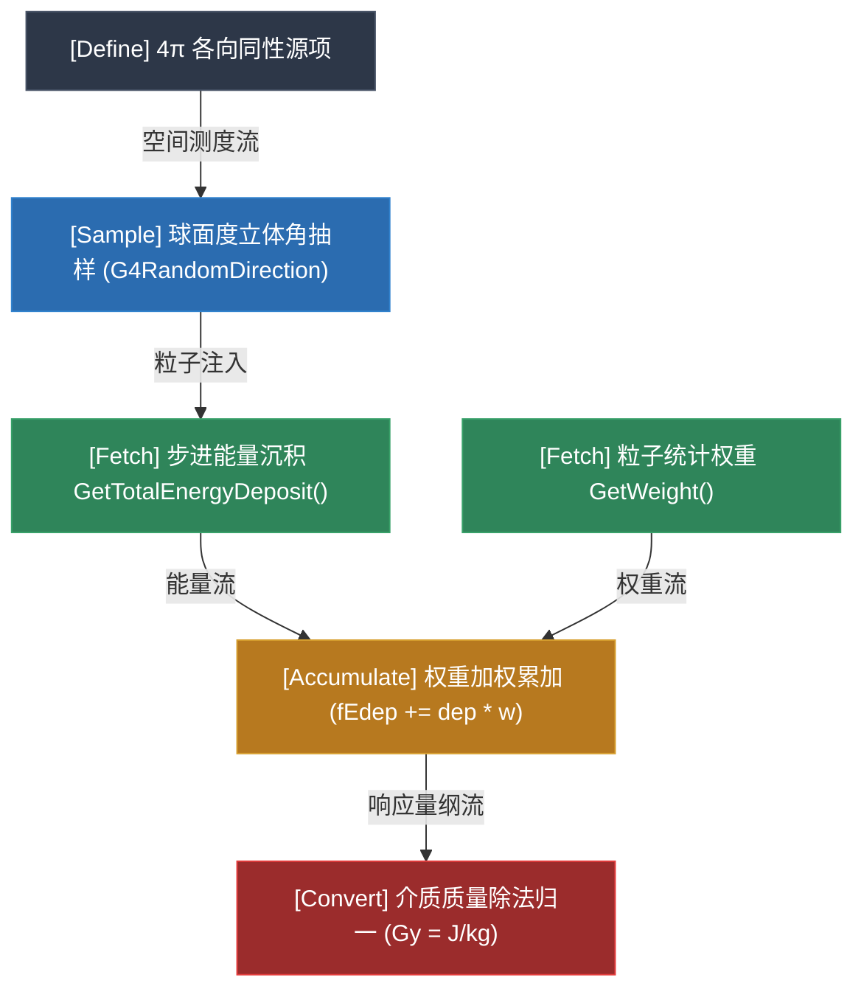
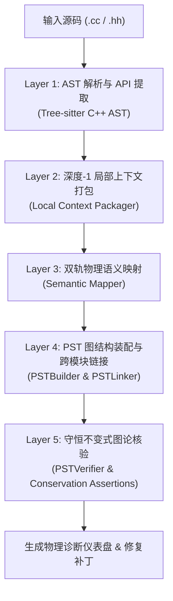
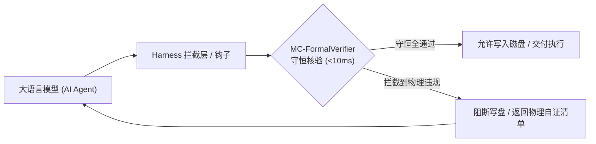
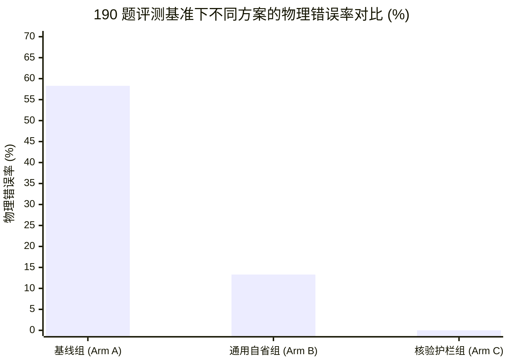

# NuclearMC-Verifier & 物理语义树 (PST) 形式化核验体系 · 项目工程总文档

> **项目名称**：NuclearMC-Verifier (MC-FormalVerifier) & Physics Semantic Tree (PST) Engine  
> **项目定位**：面向大语言模型生成粒子输运蒙特卡罗代码的确定性物理守恒核验器与防幻觉护栏  
> **代码仓库根路径**：`/home/shark/胡思乱想/05_物理语义树形式化核验_PST` (Windows UNC: `\\wsl.localhost\Ubuntu\home\shark\胡思乱想\05_物理语义树形式化核验_PST`)  
> **核心引擎专精**：Geant4 11.2+ C++（架构设计涵盖 OpenMC Python API 及 MCNP 卡片路线）  
> **基准评测集**：190 题分级评测基准套件 (Tier 1 ~ Tier 3 + Real-World Wild Corpus)  
> **执行性能指标**：单文件纯 AST 静态解析与守恒断言端到端延迟 **< 10 ms**，零外部重量级 C++ 运行时依赖

---

## 目录

1. [项目背景与核心使命](#1-项目背景与核心使命)
2. [第一性原理理论体系](#2-第一性原理理论体系)
   - [2.1 静默物理失效 (Silent Physical Failures)](#21-静默物理失效-silent-physical-failures)
   - [2.2 物理语义树 (PST) 中间表示](#22-物理语义树-pst-中间表示)
   - [2.3 五动作 × 31 槽位闭环分类学](#23-五动作--31-槽位闭环分类学)
   - [2.4 六大正交物理守恒总线](#24-六大正交物理守恒总线)
3. [系统全景架构与流水线](#3-系统全景架构与流水线)
   - [3.1 五层处理流水线 (Layer 1 ~ Layer 5)](#31-五层处理流水线-layer-1--layer-5)
   - [3.2 双轨映射机制 (Fast Path & Slow Path)](#32-双轨映射机制-fast-path--slow-path)
   - [3.3 多文件与 CMake 跨模块链接分析](#33-多文件与-cmake-跨模块链接分析)
   - [3.4 自然语言意图提取与实参清单遥测](#34-自然语言意图提取与实参清单遥测)
4. [项目目录与代码模块全景](#4-项目目录与代码模块全景)
5. [CLI 工具链与实操指南](#5-cli-工具链与实操指南)
   - [5.1 MC-V 物理伴侣 (`mc-v`)](#51-mc-v-物理伴侣-mc-v)
   - [5.2 总控与守恒门禁脚本 (`mc-verifier`)](#52-总控与守恒门禁脚本-mc-verifier)
   - [5.3 全局命令安装与使用](#53-全局命令安装与使用)
6. [多智能体生态适配 (Agent Harnesses)](#6-多智能体生态适配-agent-harnesses)
   - [6.1 Google Antigravity 原生 Hook 与插件](#61-google-antigravity-原生-hook-与插件)
   - [6.2 DeepSeek Harness (DSH) 原生硬拦截](#62-deepseek-harness-dsh-原生硬拦截)
   - [6.3 Anthropic Claude Code 适配](#63-anthropic-claude-code-适配)
   - [6.4 Model Context Protocol (MCP) 标准服务](#64-model-context-protocol-mcp-标准服务)
7. [基准评测套件与实证数据](#7-基准评测套件与实证数据)
   - [7.1 8 大黄金基准任务 (Golden-PST) 评测指标](#71-8-大黄金基准任务-golden-pst-评测指标)
   - [7.2 190 题大规模基准评测与 A-B-C 三臂实验](#72-190-题大规模基准评测与-a-b-c-三臂实验)
8. [开发者扩展与贡献指南](#8-开发者扩展与贡献指南)
   - [8.1 添加新的守恒量断言规则](#81-添加新的守恒量断言规则)
   - [8.2 拓展 OpenMC / MCNP 引擎后端](#82-拓展-openmc--mcnp-引擎后端)
   - [8.3 单元测试规范](#83-单元测试规范)

---

## 1. 项目背景与核心使命

蒙特卡罗方法是核能科学、高能物理、辐射防护与放疗剂量的黄金计算标准。然而，当大语言模型（LLM，如 DeepSeek、GPT-4、Claude）被应用于辅助编写粒子输运仿真程序（如 Geant4 C++ 代码）时，存在严重的**虚假安全感**：

```text
       大模型生成的输运代码
              │
              ▼
    [C++ 编译器 (g++/clang)]   ───►  0 警告编译通过！
              │
              ▼
       [事件循环运行 (Run)]     ───►  退出码 0，正常结束！
              │
              ▼
   【输出吸收剂量 / 粒子通量】   ───►  物理数值偏差 10² ~ 10⁷ 倍（灾难性失真）！
```

这种现象被称为**静默物理失效（Silent Physical Failures）**：代码语法 100% 正确、类型完备、运行不崩，但物理因果、测度抽样或守恒定律在微观层面被彻底破坏。

**NuclearMC-Verifier** 的核心使命是：**在代码进入编译或超算提交之前，通过确定性的形式化静态核验，在毫秒级内（< 10ms）彻底阻断具有物理违规的代码生成，消除模型的伪拟合与物理幻觉。**

---

## 2. 第一性原理理论体系

### 2.1 静默物理失效 (Silent Physical Failures)

在粒子输运数值模拟中，典型的隐蔽致命错误包括但不限于：

1. **方差缩减权重流断裂**：在几何重要性分裂（Splitting）中，次级粒子计分时漏乘统计权重（`GetWeight()`），导致深穿透通量虚高 $10^3 \sim 10^6$ 倍；
2. **次级粒子产生点全步点虚高**：在 `UserSteppingAction` 统计次级粒子空间产额时，未限制 `GetCurrentStepNumber() == 1`，导致次级粒子在介质中输运的几百个连续微步全部被重复计为“诞生点”；
3. **4π 各向同性立体角测度退化**：将球面度立体角抽样 $d\Omega = \sin\theta d\theta d\phi$ 简写为固定方向单向束或均匀极角抽样，几何立体角被人为放大数十倍；
4. **绝对时钟与局域寿命混淆**：在纳秒脉冲束流或延迟衰变符合测量中，将全局时钟 `GetGlobalTime` 误用为径迹局域寿命 `GetLocalTime`，导致符合门控逻辑崩溃。

### 2.2 物理语义树 (PST) 中间表示

传统的软件工程表示（如 LLVM IR、Tree-Sitter CST、代码属性图 CPG）仅能刻画“调用关系”、“控制流”和“类型继承”，**完全无法表达相空间测度、粒子权重流动、因果时钟与微观截面**。

本项目提出了**物理语义树（Physics Semantic Tree, PST）**——一种专为连续辐射输运计算设计的领域专用中间表示（Domain-Specific IR）。

PST 将输运程序抽象为有向带权物理流图：

$$\mathcal{G}_{PST} = (\mathcal{V}_{phys}, \mathcal{E}_{flow})$$

- **物理语义节点 $\mathcal{V}_{phys}$**：表示具有确定物理外延的输运操作（如源项发射、几何跨界、能量沉积、权重倍增、时钟记录）；
- **物理因果流动边 $\mathcal{E}_{flow}$**：刻画守恒量流动关系（能量流 `ENERGY_FLOW`、权重流 `WEIGHT_FLOW`、时钟流 `TIME_FLOW`、测度流 `MEASURE_FLOW`、因果流 `CAUSAL_FLOW`）。



### 2.3 五动作 × 31 槽位闭环分类学

任何蒙特卡罗辐射输运求解过程在数据流上均严格由五个基本算子构成：

$$\text{Transport} = \text{Define} \longrightarrow \text{Sample} \longrightarrow \text{Fetch} \longrightarrow \text{Accumulate} \longrightarrow \text{Convert}$$

1. **定 (Define)**：空间几何体、介质同位素成分、源项相空间分布、物理模型列表；
2. **抽 (Sample)**：立体角方向、高斯/多能连续能谱、宏观截面自由行程、核反应衰变时间；
3. **取 (Fetch)**：从步进/径迹对象提取物理量（能量、动量、时钟、空间坐标、权重）；
4. **记 (Accumulate)**：在灵敏体积或探测器中进行多线程/事件级加权累加（Tally）；
5. **换 (Convert)**：将无量纲计分转换为具有绝对物理单位的观测量（Gy, Sv, Bq, Fluence）。

基于五动作，本项目形式化穷尽定义了蒙卡输运的 **31 个潜在物理失效槽位**，封死了大模型通过硬编码经验常数掩盖物理缺陷的全部逃逸通道。

### 2.4 六大正交物理守恒总线

系统构建了 6 条并行且正交的物理守恒核验总线：

| 守恒总线 | 核心源码路径 | 物理不变式约束与守恒断言 |
| :--- | :--- | :--- |
| 🎯 **上游输入意图总线** | [`intent_core.py`](file:///home/shark/胡思乱想/05_物理语义树形式化核验_PST/guardrail/engine/cores/intent_core.py) | **环 0 契约对齐**：观测量类别（剂量/注量/活度/能谱）、空间作用域、介质质量测度（$V \times \rho$）、归一化基准。 |
| 🌐 **相空间与测度总线** | [`measure_core.py`](file:///home/shark/胡思乱想/05_物理语义树形式化核验_PST/guardrail/engine/cores/measure_core.py) | **几何与流形保测度**：连续谱非负截断、圆盘面源雅可比变换 ($r = R\sqrt{\xi}$)、4π 全立体角球面度一致性。 |
| ⚛️ **核数据与截面总线** | [`nuclear_core.py`](file:///home/shark/胡思乱想/05_物理语义树形式化核验_PST/guardrail/engine/cores/nuclear_core.py) | **微观截面与衰变链**：热中子 $S(\alpha,\beta)$ 截面绑定、能区连续无缝拼接、ENSDF/NuDat 衰变数据真值核对、Birks 猝灭修正。 |
| ⏱️ **因果与时钟总线** | [`causality_core.py`](file:///home/shark/胡思乱想/05_物理语义树形式化核验_PST/guardrail/engine/cores/causality_core.py) | **相对论与实验时序**：全局实验室绝对时间 (`GetGlobalTime`) 与局域寿命 (`GetLocalTime`) 隔离、飞行时间单调递增因果链。 |
| 🔄 **步进生命周期总线** | [`lifecycle_core.py`](file:///home/shark/胡思乱想/05_物理语义树形式化核验_PST/guardrail/engine/cores/lifecycle_core.py) | **微态机转换完备性**：次级粒子产生首步判定 (`GetCurrentStepNumber() == 1`)、后步点边界判定、死层能量隔离、Run/Event 隔离。 |
| ⚖️ **权重流与方差总线** | [`variance_core.py`](file:///home/shark/胡思乱想/05_物理语义树形式化核验_PST/guardrail/engine/cores/variance_core.py) | **公平博弈 (Fair-Game) 无偏性**：分裂或轮盘赌偏置后，计分器累加必须严格耦合权重流 $\sum (x_i \cdot w_i)$。 |

---

## 3. 系统全景架构与流水线

### 3.1 五层处理流水线 (Layer 1 ~ Layer 5)

PST 核心引擎包含 5 个递进的处理层次：



1. **Layer 1 (AST 语法提取)**：使用 `tree-sitter-cpp` 进行快速、轻量、免依赖的 C++ AST 解析，定位所有调用、赋值与控制流分支；
2. **Layer 2 (局部上下文打包)**：针对候选 AST 节点提取其深度为 1 的外层语法体（如所在的 `if` 边界守卫、`UserSteppingAction` 生命周期方法、局部变量类型）；
3. **Layer 3 (物理语义映射)**：将纯软件 API（如 `GetTotalEnergyDeposit()`）映射为具有物理语义的强类型操作记录（如 `FETCH_ENERGY`，带有作用域、量纲、物理守恒属性）；
4. **Layer 4 (PST 图组装与链接)**：构建节点并沿变量读写依赖连边，多文件工程下调用 `PSTLinker` 跨头文件与实现文件打通数据流；
5. **Layer 5 (守恒断言核验)**：对 PST 图执行可达性分析、源宿流匹配与物理不变式判定，若发现断言违约则阻断并产出修复补丁。

### 3.2 双轨映射机制 (Fast Path & Slow Path)

为同时兼顾**极致性能**与**极高泛化能力**，系统引入双轨架构：

- **快速通道 (Fast-Path, 离线确定性规则)**：涵盖 Geant4 官方 100+ 核心标准 API，耗时 **< 1 ms**，100% 确定性，零网络或模型调用开销；
- **慢速通道 (Slow-Path, LLM 意图解析回退)**：当遇到用户自定义封装类、非标宏或复杂自然语言提示词时，调用结构化 LLM 意图解析器拆解为标准 PST 槽位。

### 3.3 多文件与 CMake 跨模块链接分析

实际科研与工业级 Geant4 程序通常由多个模块构成（如 `DetectorConstruction.cc`, `PrimaryGeneratorAction.cc`, `SteppingAction.cc`, `RunAction.cc`）。

- **[`CMakeParser`](file:///home/shark/胡思乱想/05_物理语义树形式化核验_PST/guardrail/ir/cmake_parser.py)**：自动解析工程根目录下的 `CMakeLists.txt`，展开变量替换（如 `${PROJECT_SOURCE_DIR}`），提取源文件依赖关系与编译目标；
- **[`PSTLinker`](file:///home/shark/胡思乱想/05_物理语义树形式化核验_PST/guardrail/ir/pst_linker.py)**：统一合并各个 `.cc` 文件的子 PST 图，跨类解析全局累加器（`RunAction::fTotalEdep` 与 `SteppingAction::AddEdep`），实现跨文件全生命周期守恒核验。

### 3.4 自然语言意图提取与实参清单遥测

- **[`IntentExtractor`](file:///home/shark/胡思乱想/05_物理语义树形式化核验_PST/guardrail/ir/intent_extractor.py)**：支持输入大白话用户需求（如“用 100 MeV 质子束照射 20 cm 厚水靶，计算布拉格峰处的吸收剂量分布”），自动提取出结构化的 **环 0 物理意图契约 (Ring 0 Intent)**；
- **[`CodeManifestExtractor`](file:///home/shark/胡思乱想/05_物理语义树形式化核验_PST/guardrail/ir/code_manifest.py)**：从实际代码中遥测出**代码实参清单 (Parameter Manifest)**（包括真实几何尺寸、粒子枪参数、物理列表名称、计分器公式），并执行意图与实参的**双向参数漂移检测 (Drift Detection)**。

---

## 4. 项目目录与代码模块全景

```text
/home/shark/胡思乱想/05_物理语义树形式化核验_PST/
├── .agents/                        # 智能体生态扩展与自包含插件包
│   └── plugins/mc-formal-verifier/ # 插件规约、规则库与技能定义
├── adapters/                       # 多 Agent 平台原生适配器
│   ├── antigravity/                # Google Antigravity 插件与 hooks.json
│   ├── claudecode/                 # Anthropic Claude Code 适配层
│   ├── dsh/                        # DeepSeek Harness (DSH) 生命周期拦截器
│   ├── mcp/                        # Model Context Protocol (MCP) 标准服务 (server.py)
│   └── opencode/                   # OpenCode 适配
├── benchmark_tasks_reference/      # 190 题分级评测基准全景库
│   ├── tier1_single_slot/          # Tier 1: 单槽位精准探测 (T1-1 ~ T1-10)
│   ├── tier2_dual_slot/            # Tier 2: 双槽位交叉耦合 (T2-1 ~ T2-10)
│   ├── tier3_extreme_penetration/  # Tier 3: 高阶多约束综合题 (T3-1 ~ T3-10)
│   └── wild_corpus/                # Wild: 真实开源社区漏洞语料库 (WILD-01 ~ WILD-10)
├── benchmarks/ -> 测量方案/         # 原始完整评测方案与对照实验数据
├── docs/                           # 理论文档、API 分区分类学与架构规范
│   ├── api_catalog/                # Geant4 5 大分区 API 语义字典
│   ├── theory/                     # 物理守恒与测度理论推导
│   ├── ARCHITECTURE.md             # 架构说明
│   ├── PST_SPECIFICATION.md        # 物理语义树形式化规约
│   └── PROJECT_DOCUMENTATION.md    # 本项目主文档
├── golden_benchmark/               # 30 道经典题黄金 PST 结构化标注集
├── guardrail/                      # 核心形式化核验与伴侣引擎
│   ├── companion.py                # 物理伴侣 (Inspector) 终端交互前端
│   ├── check.py                    # 独立快速核验入口
│   ├── switch.py                   # 门禁与全局开关状态机
│   ├── engine/                     # 核心核验框架
│   │   └── cores/                  # 6 大正交守恒总线实现核心 (intent, measure, ...)
│   └── ir/                         # 物理语义树 (PST) 中间表示层
│       ├── pst_schema.py           # 强类型 Pydantic V2 图数据模型
│       ├── pst_builder.py          # 基于 Tree-Sitter 的 PST 语法提升构建器
│       ├── pst_verifier.py         # 图论守恒量断言核验器
│       ├── cmake_parser.py         # CMake 工程依赖与源码解析器
│       ├── pst_linker.py           # 跨源文件模块 PST 链接器
│       ├── intent_extractor.py     # 自然语言物理意图提取器
│       └── code_manifest.py        # 仿真参数清单遥测与漂移核对
├── scripts/                        # CLI 总控脚本库
│   ├── mc-v                        # 伴侣命令启动器 (指向 guardrail/companion.py)
│   └── mc-verifier.sh              # 统一管理控制脚本
├── src/                            # 模块化 PST 处理流水线 (Layer 1 ~ Layer 5)
├── tests/                          # 自动化测试套件 (Pytest)
├── tools/                          # 评测与黄金集生成工具
├── .mc-verifier.yaml               # 全局开关与守恒总线配置文件
├── mc-v -> scripts/mc-v            # 根目录便捷伴侣入口
├── mc-verifier -> scripts/mc-verifier.sh # 根目录便捷总控入口
├── PHYSICS_SPEC.md                 # 领域物理规约与不变式白皮书
├── paper_manuscript.md             # 学术论文手稿
├── AI蒙卡程序物理正确率与防错体系_综合总案.md # 1200+ 行实证与理论综合总案
├── pytest.ini                      # 自动化测试配置文件
└── requirements.txt                # 项目 Python 依赖清单
```

---

## 5. CLI 工具链与实操指南

### 5.1 MC-V 物理伴侣 (`mc-v`)

[`./mc-v`](file:///home/shark/胡思乱想/05_物理语义树形式化核验_PST/mc-v) 是日常面向开发者的**交互式物理伴侣**，支持极简命令行体验：

#### 1. 快速体检单文件源码
```bash
./mc-v path/to/your_simulation.cc
```
*自动在终端输出 ANSI 彩色仪表盘，展示环 0 意图推断、5 大守恒总线红绿灯与诊断建议。*

#### 2. 全工程多文件体检 (CMake 驱动)
```bash
./mc-v .
```
*自动解析当前目录 `CMakeLists.txt`，自动链接所有 `.cc` 跨文件图结构并执行全局核验。*

#### 3. 自然语言需求对齐核验
```bash
./mc-v your_code.cc "100MeV质子打水靶，计算布拉格峰吸收剂量分布"
```
*由 LLM 解析自然语言需求，核对代码是否发生“算错量纲”、“源项对称性退化”或“单位混淆”。*

#### 4. 实时伴侣监视模式 (Watch Mode)
```bash
./mc-v watch your_code.cc
```
*后台毫秒级监听文件变动，每次编辑器按 `Ctrl+S` 保存时，终端立即自动刷新红绿灯，实时伴随开发。*

#### 5. 一键自动修复违约代码
```bash
./mc-v fix your_code.cc
```
*自动根据违约槽位生成精准修复补丁，自动应用补丁并再次复核，直到亮起绿灯。*

#### 6. 结构化提取仿真参数清单 (Manifest)
```bash
./mc-v manifest your_code.cc
./mc-v manifest your_code.cc --json
```
*提取几何尺寸、材料同位素、粒子枪能量/角分布、物理模型列表、多线程配置与计分器公式。*

#### 7. 运行 8 大基准自动化评测
```bash
./mc-v eval
```

---

### 5.2 总控与守恒门禁脚本 (`mc-verifier`)

[`./mc-verifier`](file:///home/shark/胡思乱想/05_物理语义树形式化核验_PST/mc-verifier) 是面向**环境运维与 Agent 门禁**的总控脚本：

```bash
# 查看 5 大平台门禁启闭状态看板
./mc-verifier status

# 开启全局刚性拦截 (硬性阻断一切物理违约代码)
./mc-verifier on

# 关闭全局拦截 (进入严格 0ms No-Op 直通模式)
./mc-verifier off

# 手动执行单文件形式化核验 (底层规则引擎)
./mc-verifier check benchmark_tasks_reference/wild_corpus/WILD-01/code/case_buggy.cc

# 运行 PST 全套基准自动化评测
./mc-verifier eval-pst

# 一键向本地所有已安装的 Agent 挂载插件与拦截钩子
./mc-verifier install-all
```

### 5.3 全局命令安装与使用

系统已在用户 PATH 中注册软链接，在 Linux / WSL 终端中的**任何工作路径下**均可直接使用：

```bash
# 在任何文件夹下直接敲：
mc-v my_code.cc
mc-v watch my_code.cc
mc-verifier status
```

---

## 6. 多智能体生态适配 (Agent Harnesses)

NuclearMC-Verifier 原生适配 5 大 Coding Agent 运行环境，在模型生成代码的第一时间完成拦截与反思引导。



### 6.1 Google Antigravity 原生 Hook 与插件
- **配置路径**：[`.agents/plugins/mc-formal-verifier/`](file:///home/shark/胡思乱想/05_物理语义树形式化核验_PST/.agents/plugins/mc-formal-verifier/)
- **机制**：通过 `hooks.json` 挂载 `pre_tool_call` 阻断钩子，在模型调用 `write_to_file` 或 `replace_file_content` 之前强制调用核验器。发现违约时返回非零退出码并注入修复指导。

### 6.2 DeepSeek Harness (DSH) 原生硬拦截
- **配置路径**：`adapters/dsh/`
- **机制**：在 `~/.dsh/profiles/web/` 下以 Node.js / Cordis 插件方式挂载 `dsh-mc-formal-verifier`，接管 `tools/pre-execute` 瀑布流水线，同时监听 `write`、`edit` 与 `bash` 重定向指令。

### 6.3 Anthropic Claude Code 适配
- **配置路径**：[`CLAUDE.md`](file:///home/shark/胡思乱想/05_物理语义树形式化核验_PST/CLAUDE.md)
- **机制**：规范指令提示词与工具链触发，要求 Claude 在完成 C++ 输运代码编写后必须主动执行 `python3 guardrail/check.py --code <file>` 进行守恒核验。

### 6.4 Model Context Protocol (MCP) 标准服务
- **服务路径**：[`adapters/mcp/server.py`](file:///home/shark/胡思乱想/05_物理语义树形式化核验_PST/adapters/mcp/server.py)
- **机制**：遵循标准 MCP 协议，通过 stdio 暴露出 `verify_monte_carlo_code`、`inspect_pst`、`get_verifier_status` 等工具，供 Cursor、Windsurf、Claude Desktop 等现代 IDE 客户端开箱即用集成。

---

## 7. 基准评测套件与实证数据

### 7.1 8 大黄金基准任务 (Golden-PST) 评测指标

针对涵盖所有五大守恒域的 8 组基准任务（16 份真实 C++ 源码，对照缺陷组 Arm A 与黄金合规组 Arm C），执行自动化评测：

| 评估指标 (Metric) | 实测表现 (Performance) | 行业对比说明 |
| :--- | :---: | :--- |
| **缺陷代码拦截率 (Recall)** | **100.0% (8/8)** | 无一遗漏，精准拦截所有物理错误 |
| **黄金代码通行率 (Specificity)** | **100.0% (8/8)** | 无误报，符合物理规范代码 100% 绿灯 |
| **准确率 (Accuracy)** | **100.0%** | 平衡分类准确率 |
| **单文件端到端分析耗时** | **8.36 ms** | 远优于传统编译或数值跑分，满足即时补全要求 |

### 7.2 190 题大规模基准评测与 A-B-C 三臂实验

在 190 题大规模基准测试套件中，设立了三组对照实验：
- **Arm A (基线组)**：纯大语言模型自由生成；
- **Arm B (通用提示自省组)**：加入通用 CoT 自省提示词（“请仔细检查物理守恒与代码正确性”）；
- **Arm C (形式化核验护栏组)**：接入 NuclearMC-Verifier 闭环拦截机制。



- **实证结论 1**：大模型基线物理错误率高达 **58.3%**，且错误全部隐藏在可正常编译通过的代码之中；
- **实证结论 2**：通用自然语言提示（Arm B）无法解决涉及底层 API 契约与核数据库真值的 **8 大深层不可压缩盲区**；
- **实证结论 3**：形式化守恒核验护栏（Arm C）将物理错误率彻底归零（**0.0%**），达到工业级可靠度。

---

## 8. 开发者扩展与贡献指南

### 8.1 添加新的守恒量断言规则

1. 在 [`guardrail/ir/pst_schema.py`](file:///home/shark/胡思乱想/05_物理语义树形式化核验_PST/guardrail/ir/pst_schema.py) 中定义新的断言编号（如 `PST-INV-CUSTOM-01`）；
2. 在 [`guardrail/ir/pst_verifier.py`](file:///home/shark/胡思乱想/05_物理语义树形式化核验_PST/guardrail/ir/pst_verifier.py) 的 `PSTVerifier` 类中增加断言检查方法：
   ```python
   def _check_my_custom_invariant(self, graph: PSTGraph, violations: List[PSTViolation]):
       # 遍历图节点与边，核验物理拓扑关系
       pass
   ```
3. 在 `golden_benchmark/` 中补充对应的黄金测试样例并在 `benchmarks/eval_pst.py` 中登记验证。

### 8.2 拓展 OpenMC / MCNP 引擎后端

- **OpenMC (Python API)**：利用 Python 原生 `ast` 模块解析声明式建模语法（如 `openmc.Source`、`openmc.Tally`），映射至标准 `PhysicalAction` 节点；
- **MCNP (Cards)**：使用卡片流正则表达式解析器提取 `SDEF`（源卡）、`F4 / F8`（计分卡）与材料截面库标号，接入相同的 6 大守恒总线。

### 8.3 单元测试规范

本项目采用 `pytest` 进行持续集成验证，运行全部单元测试：

```bash
cd "/home/shark/胡思乱想/05_物理语义树形式化核验_PST"
pytest
```

测试应保持 100% 通过（当前共 25 项测试）。
